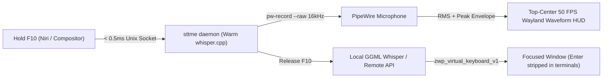

# sttme

[](https://github.com/maxfridbe/sttme/actions/workflows/build.yml)
[](LICENSE)
[-orange.svg)](https://github.com/maxfridbe/sttme)

**`sttme`** is a single-executable, `#![forbid(unsafe_code)]` Rust speech-to-text daemon and CLI for Linux Wayland desktops (ported from [TalkType](https://github.com/lmacan1/talktype)).

Hold down a global hotkey (`F10`), speak while watching a live `50 FPS` top-center Wayland waveform HUD, and release the key to transcribe locally with `whisper.cpp` and type directly into whichever window is focused—with **sub-millisecond startup** and **zero focus stealing**.

<p align="center">
  
</p>

---

## Features

- **Single Standalone Binary**: Packs the push-to-talk client, hot-model background daemon (`whisper.cpp` via `whisper-rs`), TalkType-compatible HTTP API (`/health`, `/stats`, `/transcribe`), recovery/retry store, diagnostics (`doctor`), and interactive setup wizard into one `~8 MB` executable.
- **Sub-Millisecond Hotkey IPC (`< 0.5ms`)**: `sttme hold` communicates synchronously over `$XDG_RUNTIME_DIR/sttme.sock` with a warm `systemd --user` daemon keeping Whisper resident in RAM—no Python interpreter startup or cold model loads.
- **Global Hold-to-Talk Without Stealing Focus**: Uses compositor key-repeat leases + `KeyboardInteractivity::None` on `zwlr_layer_shell_v1` so your active browser, IDE, chat window, or terminal never loses keyboard focus while dictating.
- **Top-Center `50 FPS` Live Waveform HUD**: Renders an anti-aliased `320x62` LCARS pill anchored at the top-center of your Wayland output (`Layer::Overlay` + double-buffered `wl_shm` `ARGB8888`) driven by real-time 16 kHz PipeWire PCM metering with adaptive gain normalization.
- **Safe Terminal Dictation**: Automatically strips all Enter/Return/newline keystrokes (`\r`, `\n`, `\u2028`, `\u2029`, `\u0085`, and control characters) when typing into Alacritty or other terminals so dictated speech never accidentally executes shell commands.
- **Zero External Wayland Helpers Required**: Speaks Wayland `zwp_virtual_keyboard_v1` (with dynamic Unicode XKB keymaps), `zwlr_layer_shell_v1`, PipeWire `pw-record --raw`, and `$NIRI_SOCKET` IPC directly in safe Rust—no `ydotool`, `wtype`, or `/dev/input` root permissions needed.
- **Embedded LCARS Audio Cues**: Plays embedded start-listening and transcription-complete audio cues out of the box (no external asset files required at runtime).
- **Resilience Built In**: Automatically saves `pending.wav` before inference (`sttme retry`) and maintains a rolling `history.jsonl` (`sttme recover`) so dictated speech is never lost.

---

## How It Works



---

## Installation

### 1. One-Line Install Script (Recommended)

Downloads the latest verified Linux binary (`x86_64` or `aarch64`)—or builds from source automatically if Cargo is installed and no prebuilt binary matches—sets up `~/.config/sttme/config.toml`, caches the `base` Whisper model (`~147 MB`), and enables the `systemd --user` background daemon:

```bash
curl -fsSL https://raw.githubusercontent.com/maxfridbe/sttme/main/install.sh | bash
```

Customize the installation with flags if needed:

```bash
curl -fsSL https://raw.githubusercontent.com/maxfridbe/sttme/main/install.sh | bash -s -- \
  --bin-dir ~/.local/bin \
  --model small
```

### 2. Prebuilt Linux Release Archive

Download the latest archive for your architecture from [**GitHub Releases**](https://github.com/maxfridbe/sttme/releases):

```bash
ARCH="$(uname -m)" # x86_64 or aarch64
curl -fsSLO "https://github.com/maxfridbe/sttme/releases/latest/download/sttme-linux-${ARCH}.tar.gz"
curl -fsSLO "https://github.com/maxfridbe/sttme/releases/latest/download/SHA256SUMS"
grep "sttme-linux-${ARCH}.tar.gz" SHA256SUMS | sha256sum -c -

tar -xzf "sttme-linux-${ARCH}.tar.gz"
./install.sh
```

### 3. Build from Source

Install native build prerequisites (`cmake`, `clang`, `libclang`, `alsa-lib` headers, and PipeWire tools):

```bash
# Fedora / Fedora Silverblue (toolbox / distrobox)
sudo dnf install -y gcc gcc-c++ cmake clang clang-devel alsa-lib-devel pipewire-utils

# Debian / Ubuntu
sudo apt-get install -y build-essential cmake clang libclang-dev pkg-config libasound2-dev pipewire-bin

# Arch Linux
sudo pacman -S --needed base-devel cmake clang alsa-lib pipewire
```

Clone and install:

```bash
git clone https://github.com/maxfridbe/sttme.git
cd sttme
./install.sh --from-source
```

### Uninstall

```bash
./uninstall.sh
# Or remove config (~/.config/sttme) and downloaded models (~/.cache/sttme) as well:
./uninstall.sh --purge
```

---

## Desktop Hotkey Setup

### Niri (Recommended Global `F10` Hold-to-Talk)

Add this inside `binds { ... }` in `~/.config/niri/config.kdl`:

```kdl
    F10 repeat=true cooldown-ms=70 hotkey-overlay-title="Hold to Dictate (sttme)" { spawn "~/.local/bin/sttme" "hold" "--key" "f10" "--target" "all" "--quiet"; }
```

*(Note: if Niri does not expand `~` in `spawn`, use `/home/<your-user>/.local/bin/sttme` or `spawn-sh "~/.local/bin/sttme hold --key f10 --target all --quiet"`.)*

Reload Niri config:

```bash
niri msg action load-config-file
```

### Hyprland (`~/.config/hypr/hyprland.conf`)

```ini
bind  = , F10, exec, ~/.local/bin/sttme start --target all
bindr = , F10, exec, ~/.local/bin/sttme stop
```

### Sway (`~/.config/sway/config`)

```text
bindsym --no-repeat F10 exec ~/.local/bin/sttme start --target all
bindsym --release F10 exec ~/.local/bin/sttme stop
```

### Alacritty-Only Keybinding (`~/.config/alacritty/alacritty.toml`)

If you prefer binding inside Alacritty using Wayland exclusive keyboard-release tracking (`--grab`):

```toml
[[keyboard.bindings]]
key = "F10"
command = { program = "sttme", args = ["hold", "--key", "f10", "--grab", "--target", "alacritty", "--quiet"] }
```

---

## CLI Reference

```bash
# Hold-to-talk (default action when invoking `sttme` with no arguments)
sttme hold --key f10 --target all --quiet

# Toggle recording on/off (press once to start, press again to transcribe)
sttme toggle

# Explicit start / stop / cancel (ideal for compositors with separate press/release binds)
sttme start
sttme stop
sttme cancel

# Re-type the last successful transcription (~/.cache/sttme/history.jsonl)
sttme recover

# Re-transcribe failed audio saved at ~/.cache/sttme/pending.wav
sttme retry

# Check daemon status, loaded model, and latency statistics
sttme status

# Verify Wayland virtual keyboard, layer-shell HUD, PipeWire, and focused window
sttme doctor

# Pre-download a Whisper GGML model (tiny, base, small, medium, large-v3, large-v3-turbo)
sttme download-model base

# Transcribe a WAV file directly from disk
sttme transcribe recording.wav

# Run interactive configuration wizard
sttme --setup

# Run daemon + TalkType-compatible HTTP transcription server on 127.0.0.1:8002
sttme serve --port 8002
```

---

## Configuration

Configuration lives at `~/.config/sttme/config.toml` (automatically migrated from `~/.config/talktype/config.yaml` on first run if present):

```toml
[transcription]
mode = "local"              # "local" (whisper.cpp) or "api" (OpenAI-compatible HTTP endpoint)
model = "base"              # tiny, tiny.en, base, base.en, small, medium, large-v3, large-v3-turbo
language = "en"             # ISO 639-1 code ("en", "es", "de", ...) or omit for auto-detect
energy_threshold = 0.008    # Silence RMS gate before running Whisper

# Optional remote API settings when mode = "api":
# api_url = "http://127.0.0.1:8002"
# api_key = "sk-..."
# api_model = "whisper-1"

[target]
alacritty_only = false        # false = type into any focused app; true = Alacritty only
strip_alacritty_enter = true  # Strip Enter/newlines in terminals so commands never auto-run
trailing_space = true         # Append a trailing space after each dictated phrase
input_method = "type"         # "type" (Wayland virtual keyboard) or "paste" (clipboard + Ctrl+V)

[ui]
audio_beeps = true            # Play embedded start/stop audio cues
waveform_overlay = true       # Show top-center 50 FPS Wayland live waveform HUD while listening
minimal = false

[history]
limit = 100                   # Rolling entries retained in ~/.cache/sttme/history.jsonl
```

### Whisper GGML Models

Models are downloaded automatically on first use to `~/.cache/sttme/models/ggml-<model>.bin`:

| Model | Disk Size | Speed | Best For |
| :--- | :--- | :--- | :--- |
| `tiny` / `tiny.en` | ~75 MB | Fastest | Ultra-low-power laptops, quick short commands |
| `base` / `base.en` | ~147 MB | Instant *(default)* | Everyday desktop dictation with sub-300ms CPU latency |
| `small` / `small.en` | ~466 MB | Fast | Higher technical/punctuation accuracy |
| `medium` | ~1.5 GB | Moderate | Multilingual & complex vocabulary |
| `large-v3-turbo` | ~1.6 GB | Fast-Moderate | Near `large-v3` accuracy at significantly higher speed |
| `large-v3` | ~3.1 GB | Heavy | Maximum transcription fidelity |

---

## TalkType-Compatible HTTP API

Run `sttme serve --port 8002` (or `sttme daemon --http-port 8002`) to expose an HTTP server drop-in compatible with `TalkType`'s `whisper_server.py`:

```bash
curl -s http://127.0.0.1:8002/health | jq
curl -s http://127.0.0.1:8002/stats | jq
curl -s -X POST http://127.0.0.1:8002/transcribe -F "file=@sample.wav" -F "language=en" | jq
```

---

## Service Management & Troubleshooting

```bash
# View live daemon logs
journalctl --user -u sttme.service -f

# Restart daemon after editing ~/.config/sttme/config.toml
systemctl --user restart sttme.service

# Run full Wayland / compositor / model readiness check
sttme doctor
```

---

## License & Acknowledgements

Licensed under the [MIT License](LICENSE). Inspired by and compatible with [lmacan1/talktype](https://github.com/lmacan1/talktype).
