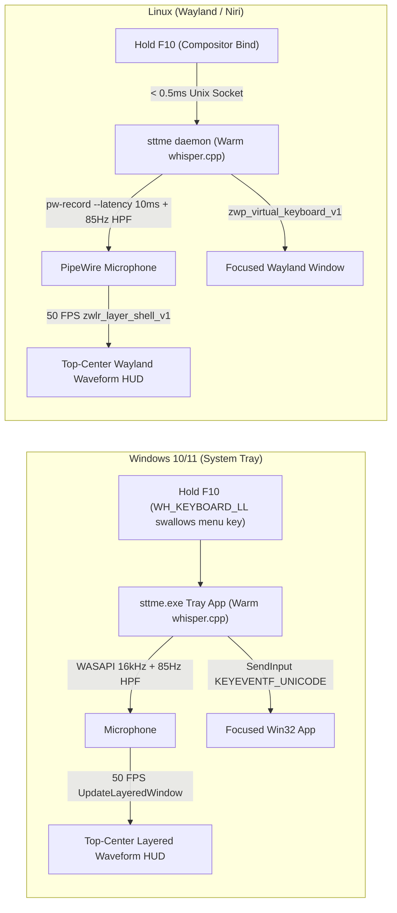

# sttme

[](https://github.com/maxfridbe/sttme/actions/workflows/build.yml)
[](https://github.com/maxfridbe/sttme/releases/latest)
[](LICENSE)
[%20%7C%20Windows%2010%2F11%20(Tray)-orange.svg)](https://github.com/maxfridbe/sttme/releases)

**`sttme`** is a single-executable local Whisper speech-to-text push-to-talk tool written in Rust for **Linux Wayland desktops** and **Windows 10/11 (System Tray)** (ported and expanded from [TalkType](https://github.com/lmacan1/talktype)).

Hold down **`F10`** in any window, speak while watching a live `50 FPS` top-center LCARS waveform HUD, and release **`F10`** to transcribe locally on CPU with `whisper.cpp` and type directly into whichever window is focused—with **sub-millisecond startup** and **zero focus stealing**.

<p align="center">
  
</p>

---

## Features

- **Single Standalone Executable (`sttme` / `sttme.exe`)**:
  - Packs local `whisper.cpp` inference, live `50 FPS` top-center waveform HUD, embedded LCARS audio cues, TalkType-compatible HTTP API (`/health`, `/transcribe`), recovery/retry store, diagnostics (`doctor`), and setup wizard into one self-contained binary.
- **Native Windows 10/11 System Tray Application**:
  - Runs silently in the Windows Notification Area with zero console window (`windows_subsystem = "windows"`).
  - Global low-level keyboard hook (`WH_KEYBOARD_LL`) intercepts **Hold `F10`** and **swallows `F10` menu-bar activation** so Windows app menu bars never pop up while dictating (`Esc` cancels mid-hold).
  - Per-Monitor DPI-Aware V2 `50 FPS` click-through `UpdateLayeredWindow` LCARS waveform HUD anchored at the top-center of your active monitor.
  - Right-click tray menu to switch **Hold Hotkey** (`F10`, `F9`, `F12`, `Right Ctrl`, `Right Alt`), hot-swap **Whisper Model** (`tiny`, `base`, `base.en`, `small`, `large-v3-turbo`), toggle HUD / audio cues / terminal Enter stripping, toggle **Launch at Windows Sign-In**, or **Copy & Recover Last Dictation**.
  - Modern Inno Setup GUI installer built reproducibly via Docker (`packaging/windows/Dockerfile`), supporting non-elevated user installation, Start Menu / Desktop shortcuts, User `PATH` registration, and clean uninstallation.
- **Native Linux Wayland / Niri Daemon**:
  - `#![forbid(unsafe_code)]` on Linux, speaking `zwp_virtual_keyboard_v1`, `zwlr_layer_shell_v1`, PipeWire `pw-record --raw`, and `$NIRI_SOCKET` IPC directly in safe Rust—no `ydotool`, `wtype`, or `/dev/input` root permissions needed.
  - `< 0.5ms` Unix socket IPC (`$XDG_RUNTIME_DIR/sttme.sock`) with a warm `systemd --user` background service keeping Whisper resident in RAM.
- **Safe Terminal Dictation**: Automatically strips all Enter/Return/newline keystrokes (`\r`, `\n`, `\u2028`, `\u2029`, `\u0085`, and control characters) when typing into terminals (`Alacritty`, `Windows Terminal`, `PowerShell`, `cmd`, `kitty`, `wezterm`, `foot`, `ghostty`) so dictated speech never accidentally executes shell commands.
- **DC-Blocked Real-Time Microphone DSP**: Built-in `85 Hz` high-pass filter + `40ms` hardware wakeup pop gate eliminates MEMS DC bias so the `50 FPS` waveform stays flat in silence and spikes strictly on your voice.

---

## Quick Install

### Windows 10 / 11 (System Tray App)

#### 1. Graphical Installer (Recommended)
Download and run [**`sttme-windows-x86_64-setup.exe`**](https://github.com/maxfridbe/sttme/releases/latest/download/sttme-windows-x86_64-setup.exe) from GitHub Releases:
- Installs to `%LOCALAPPDATA%\Programs\sttme` (no Administrator / UAC elevation prompt required)
- Creates Start Menu & optional Desktop shortcuts
- Optional toggle: **Launch at Windows Sign-In** (`HKCU\Software\Microsoft\Windows\CurrentVersion\Run`)
- Optional toggle: Add `sttme` to User `PATH` for Command Prompt & PowerShell CLI access
- Automatically shuts down running instances during upgrades
- Built in CI via Docker using Inno Setup 6

#### 2. One-Line PowerShell Installer
Alternatively, install directly via PowerShell:

```powershell
irm https://raw.githubusercontent.com/maxfridbe/sttme/main/install.ps1 | iex
```

Custom PowerShell install parameters:
```powershell
# Custom install directory and startup options
& ([scriptblock]::Create((irm https://raw.githubusercontent.com/maxfridbe/sttme/main/install.ps1))) `
  -InstallDir "$env:LOCALAPPDATA\Programs\sttme" `
  -Model "base" `
  -Startup
```

#### 3. Portable Archive
Download [**`sttme-windows-x86_64.zip`**](https://github.com/maxfridbe/sttme/releases/latest/download/sttme-windows-x86_64.zip) for a portable standalone binary. Extract anywhere and launch `sttme.exe`.

#### Windows Uninstallation
Uninstall anytime via **Windows Settings → Apps → Installed apps → sttme → Uninstall**, or via PowerShell:

```powershell
irm https://raw.githubusercontent.com/maxfridbe/sttme/main/uninstall.ps1 | iex
```

---

### Linux (Wayland / Niri / Hyprland / Sway)

#### 1. One-Line Install Script (Recommended)

Downloads the latest verified Linux binary (`x86_64` or `aarch64`), configures `~/.config/sttme/config.toml`, pre-caches the default `base` Whisper model (`~147 MB`), installs a desktop launcher, and enables the `systemd --user` background daemon:

```bash
curl -fsSL https://raw.githubusercontent.com/maxfridbe/sttme/main/install.sh | bash
```

Customize the Linux installation with flags if desired:

```bash
curl -fsSL https://raw.githubusercontent.com/maxfridbe/sttme/main/install.sh | bash -s -- \
  --bin-dir ~/.local/bin \
  --model small
```

#### 2. Prebuilt Linux Release Archive

Download the archive and verified checksum for your CPU architecture from [**GitHub Releases**](https://github.com/maxfridbe/sttme/releases/latest):

```bash
ARCH="$(uname -m)" # x86_64 or aarch64
curl -fsSLO "https://github.com/maxfridbe/sttme/releases/latest/download/sttme-linux-${ARCH}.tar.gz"
curl -fsSLO "https://github.com/maxfridbe/sttme/releases/latest/download/SHA256SUMS"
grep "sttme-linux-${ARCH}.tar.gz" SHA256SUMS | sha256sum -c -

tar -xzf "sttme-linux-${ARCH}.tar.gz"
./install.sh
```

#### 3. Linux Daemon Management (`systemd --user`)

Once installed, `sttme` runs as a warm user service:

```bash
# Check service status and active Whisper model
systemctl --user status sttme.service

# Restart daemon (e.g. after editing config.toml)
systemctl --user restart sttme.service

# Stream live transcription logs
journalctl --user -u sttme.service -f
```

#### 4. Linux Uninstallation

```bash
~/.local/bin/sttme-uninstall
# or via curl:
curl -fsSL https://raw.githubusercontent.com/maxfridbe/sttme/main/uninstall.sh | bash
```

---

### Build from Source

<details>
<summary><b>Linux source build instructions</b></summary>

```bash
# Fedora / Fedora Silverblue
sudo dnf install -y gcc gcc-c++ cmake clang clang-devel alsa-lib-devel pipewire-utils

# Debian / Ubuntu
sudo apt-get install -y build-essential cmake clang libclang-dev pkg-config libasound2-dev pipewire-bin

# Arch Linux
sudo pacman -S --needed base-devel cmake clang alsa-lib pipewire

git clone https://github.com/maxfridbe/sttme.git
cd sttme
./install.sh --from-source
```
</details>

<details>
<summary><b>Windows source build instructions (MSVC + CMake + Rust)</b></summary>

```powershell
git clone https://github.com/maxfridbe/sttme.git
cd sttme
.\install.ps1 -FromSource
```
</details>

---

## How It Works



---

## Desktop Hotkey Setup

### Windows 10 / 11

No extra compositor or shortcut configuration needed. When `sttme.exe` runs in the Notification Area:
- **Hold `F10`**: Starts recording immediately, shows top-center waveform HUD, and plays the LCARS cue. Windows menu-bar activation on `F10` is automatically intercepted and suppressed.
- **Release `F10`**: Stops recording, runs local CPU inference, and types the text into the active window.
- **Press `Esc` while holding `F10`**: Instantly cancels the recording without transcribing.
- **Change Hotkey**: Right-click the tray icon and choose **Hotkey → F10 / F9 / F12 / Right Ctrl / Right Alt**.

### Linux: Niri (`~/.config/niri/config.kdl`)

Add this inside `binds { ... }` in `~/.config/niri/config.kdl`:

```kdl
    F10 repeat=true cooldown-ms=70 hotkey-overlay-title="Hold to Dictate (sttme)" { spawn "~/.local/bin/sttme" "hold" "--key" "f10" "--target" "all" "--quiet"; }
```

*(Note: if Niri does not expand `~` in `spawn`, use `/home/<your-user>/.local/bin/sttme`.)*

Reload Niri without restarting:
```bash
niri msg action load-config-file
```

### Linux: Hyprland (`~/.config/hypr/hyprland.conf`)

```ini
bind  = , F10, exec, ~/.local/bin/sttme start --target all
bindr = , F10, exec, ~/.local/bin/sttme stop
```

### Linux: Sway (`~/.config/sway/config`)

```text
bindsym --no-repeat F10 exec ~/.local/bin/sttme start --target all
bindsym --release F10 exec ~/.local/bin/sttme stop
```

---

## Windows System Tray Menu

Right-clicking the `sttme` tray icon exposes instant runtime controls without restarting the app:

| Menu Item | Description |
| :--- | :--- |
| **Model** | Live switch between cached models: `tiny`, `base`, `base.en`, `small`, `large-v3-turbo` (auto-downloads if needed) |
| **Hotkey** | Live switch global hold key: `F10`, `F9`, `F12`, `Right Ctrl`, `Right Alt` |
| **Audio Beeps** | Toggle embedded LCARS start/stop chimes |
| **Waveform HUD** | Toggle the 50 FPS top-center real-time speech HUD |
| **Strip Terminal Enter** | Toggle stripping of newlines and carriage returns when dictating into terminal windows |
| **Launch at Sign-In** | Toggle auto-start on Windows boot via `HKCU\Software\Microsoft\Windows\CurrentVersion\Run` |
| **Copy Last Dictation** | Copies the most recent transcription directly to the Windows clipboard for instant paste recovery |
| **Open config.toml** | Opens `%APPDATA%\sttme\config.toml` in your default text editor |
| **Open Logs Folder** | Opens `%LOCALAPPDATA%\sttme\logs` |
| **Doctor Diagnostics** | Runs self-check diagnostics against WASAPI audio devices, models, and write permissions |
| **Exit** | Gracefully unhooks the global keyboard hook and terminates the background tray app |

---

## CLI Reference

`sttme` provides a unified CLI on both Linux and Windows:

```bash
# Windows default (no args): launches System Tray app with zero console window
sttme.exe

# Linux default (no args): hold-to-talk over Unix socket IPC
sttme hold --key f10 --target all --quiet

# Manual start / stop / toggle / cancel (Linux daemon IPC)
sttme start           # Begin recording audio
sttme stop            # Stop recording and transcribe into focused window
sttme toggle          # Toggle recording on/off (press-to-talk)
sttme cancel          # Abort current recording without transcribing
sttme status          # Print current daemon status (idle, recording, transcribing)

# Recovery and history
sttme recover         # Re-inject the last transcription into the focused window
sttme retry           # Re-run transcription on the last recorded WAV audio file
sttme history         # Display recent transcription history

# System health and diagnostics (works on Linux & Windows)
sttme doctor

# Whisper GGML model management
sttme download-model base   # Pre-cache a model (tiny, base, base.en, small, medium, large-v3, large-v3-turbo)

# Transcribe a WAV file directly from disk
sttme transcribe recording.wav

# Interactive configuration wizard
sttme --setup

# TalkType-compatible HTTP transcription server on 127.0.0.1:8002
sttme serve --port 8002
```

---

## Configuration

Configuration is stored in TOML format:
- **Linux**: `~/.config/sttme/config.toml`
- **Windows**: `%APPDATA%\sttme\config.toml` *(accessible via **Right-click Tray Icon → Open config.toml**)*

```toml
[transcription]
mode = "local"              # "local" (whisper.cpp) or "api" (OpenAI-compatible HTTP endpoint)
model = "base"              # tiny, tiny.en, base, base.en, small, medium, large-v3, large-v3-turbo
language = "en"             # ISO 639-1 code ("en", "es", "de", ...) or omit for auto-detect
energy_threshold = 0.008    # Silence RMS gate before running Whisper

[target]
hotkey = "f10"                # Windows global hold key: f10, f9, f12, rctrl, ralt
alacritty_only = false        # false = type into any focused app; true = Alacritty only
strip_alacritty_enter = true  # Strip Enter/newlines in terminals so commands never auto-run
trailing_space = true         # Append a trailing space after each dictated phrase
input_method = "type"         # "type" (Virtual Keyboard / SendInput) or "paste" (Clipboard + Ctrl+V)

[ui]
audio_beeps = true            # Play embedded LCARS start/stop audio cues
waveform_overlay = true       # Show top-center 50 FPS live speech waveform HUD while listening

[history]
limit = 100                   # Rolling entries retained in history.jsonl
```

---

## Whisper GGML Models

Models are downloaded automatically on first use (`~/.cache/sttme/models` on Linux, `%LOCALAPPDATA%\sttme\models` on Windows):

| Model | Disk Size | Speed | Best For |
| :--- | :--- | :--- | :--- |
| `tiny` / `tiny.en` | ~75 MB | Fastest | Ultra-low-power laptops, quick short commands |
| `base` / `base.en` | ~147 MB | Instant *(default)* | Everyday desktop dictation with sub-300ms CPU latency |
| `small` / `small.en` | ~466 MB | Fast | Higher technical/punctuation accuracy |
| `medium` | ~1.5 GB | Moderate | Multilingual & complex vocabulary |
| `large-v3-turbo` | ~1.6 GB | Fast-Moderate | Near `large-v3` accuracy at significantly higher speed |
| `large-v3` | ~3.1 GB | Heavy | Maximum transcription fidelity |

---

## Packaging & Reproducible Builds

Both native Linux packages and the Windows Inno Setup installer can be packaged locally or in CI:

### Windows Inno Setup Installer (Docker / Podman)

The Windows installer is compiled with Inno Setup 6 inside a Docker container, requiring no Windows host or Wine setup:

```bash
# Uses Docker or rootless Podman automatically
./packaging/windows/build-installer.sh "26.1030.1"

# The output installer is generated at:
# dist/sttme-windows-x86_64-setup.exe
```

All build scripts adhere to strict POSIX / ShellCheck standards (`packaging/windows/build-installer.sh`, `install.sh`, `uninstall.sh`).

---

## Troubleshooting & Diagnostics

Run `sttme doctor` anytime to verify your environment:

```bash
sttme doctor
```

It automatically verifies:
- Audio input device availability (PipeWire on Linux, WASAPI on Windows)
- Recording sample rates and channel compatibility
- Whisper model cache directories and file permissions
- Wayland compositor protocols (`zwlr_layer_shell_v1`, `zwp_virtual_keyboard_v1`) or Windows keyboard hook capabilities
- Configuration file validity

If you experience issues on Linux:
- Check that your user is in the `input` group if using raw input, or ensure PipeWire is active (`systemctl --user status pipewire`).
- Review daemon logs: `journalctl --user -u sttme.service -n 50`.

If you experience issues on Windows:
- Ensure your antivirus does not block global keyboard hooks.
- Check `%LOCALAPPDATA%\sttme\logs\sttme.log` for any runtime errors.

---

## License & Acknowledgements

Licensed under the [MIT License](LICENSE). Inspired by and compatible with [lmacan1/talktype](https://github.com/lmacan1/talktype).
