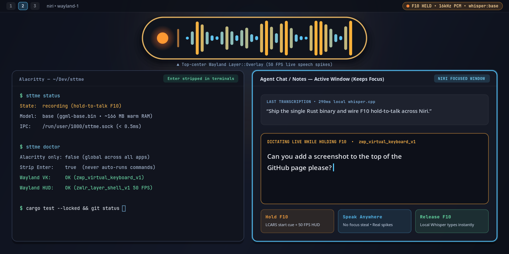
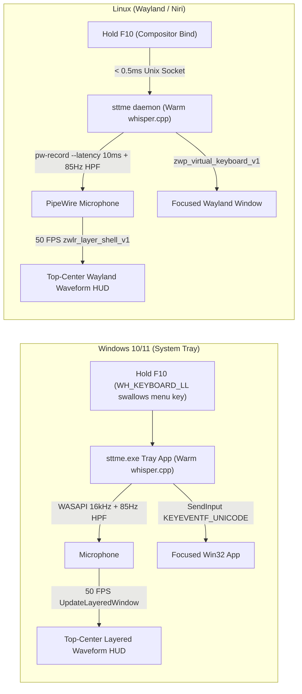

# sttme

[](https://github.com/maxfridbe/sttme/actions/workflows/build.yml)
[](LICENSE)
[%20%7C%20Windows%2010%2F11%20(Tray)-orange.svg)](https://github.com/maxfridbe/sttme/releases)

**`sttme`** is a single-executable local Whisper speech-to-text push-to-talk tool written in Rust for **Linux Wayland desktops** and **Windows 10/11 (System Tray)** (ported from [TalkType](https://github.com/lmacan1/talktype)).

Hold down **`F10`** in any window, speak while watching a live `50 FPS` top-center LCARS waveform HUD, and release **`F10`** to transcribe locally on CPU with `whisper.cpp` and type directly into whichever window is focused—with **sub-millisecond startup** and **zero focus stealing**.

<p align="center">
  
</p>

---

## Features

- **Single Standalone Executable (`sttme` / `sttme.exe`)**: Packs local `whisper.cpp` inference, live `50 FPS` top-center waveform HUD, embedded LCARS audio cues, TalkType-compatible HTTP API (`/health`, `/transcribe`), recovery/retry store, diagnostics (`doctor`), and setup wizard into one self-contained binary.
- **Native Windows 10/11 System Tray Application**:
  - Runs silently in the Windows Notification Area with zero console window (`windows_subsystem = "windows"`).
  - Global low-level keyboard hook (`WH_KEYBOARD_LL`) intercepts **Hold `F10`** and **swallows `F10` menu-bar activation** so Windows app menu bars never pop up while dictating (`Esc` cancels mid-hold).
  - Per-Monitor DPI-Aware V2 `50 FPS` click-through `UpdateLayeredWindow` LCARS waveform HUD anchored at the top-center of your active monitor.
  - Right-click tray menu to switch **Hold Hotkey** (`F10`, `F9`, `F12`, `Right Ctrl`, `Right Alt`), hot-swap **Whisper Model** (`tiny`, `base`, `base.en`, `small`, `large-v3-turbo`), toggle HUD/audio cues/terminal Enter stripping, toggle **Launch at Windows Sign-In**, or **Copy & Recover Last Dictation**.
- **Native Linux Wayland / Niri Daemon**:
  - `#![forbid(unsafe_code)]` on Linux, speaking `zwp_virtual_keyboard_v1`, `zwlr_layer_shell_v1`, PipeWire `pw-record --raw`, and `$NIRI_SOCKET` IPC directly in safe Rust—no `ydotool`, `wtype`, or `/dev/input` root permissions needed.
  - `< 0.5ms` Unix socket IPC (`$XDG_RUNTIME_DIR/sttme.sock`) with a warm `systemd --user` background service keeping Whisper resident in RAM.
- **Safe Terminal Dictation**: Automatically strips all Enter/Return/newline keystrokes (`\r`, `\n`, `\u2028`, `\u2029`, `\u0085`, and control characters) when typing into terminals (`Alacritty`, `Windows Terminal`, `PowerShell`, `cmd`, `kitty`, `wezterm`, `foot`, `ghostty`) so dictated speech never accidentally executes shell commands.
- **DC-Blocked Real-Time Microphone DSP**: Built-in `85 Hz` high-pass filter + `40ms` hardware wakeup pop gate eliminates MEMS DC bias so the `50 FPS` waveform stays flat in silence and spikes strictly on your voice.

---

## Quick Install

### Windows 10 / 11 (System Tray App)

Run this one-liner in **PowerShell** to download the latest SHA-256 verified `sttme-windows-x86_64.zip` release, cache the `base` Whisper model (`~147 MB`), enable **Launch at Windows Sign-In**, and start `sttme.exe` in your System Tray:

```powershell
irm https://raw.githubusercontent.com/maxfridbe/sttme/main/install.ps1 | iex
```

Or download **`sttme-windows-x86_64.zip`** directly from [**GitHub Releases**](https://github.com/maxfridbe/sttme/releases), extract it anywhere, and either run `sttme.exe` portably or run `.\install.ps1`.

Uninstall on Windows anytime:

```powershell
irm https://raw.githubusercontent.com/maxfridbe/sttme/main/uninstall.ps1 | iex
```

---

### Linux (Wayland / Niri / Hyprland / Sway)

#### 1. One-Line Install Script (Recommended)

Downloads the latest verified Linux binary (`x86_64` or `aarch64`), sets up `~/.config/sttme/config.toml`, caches the `base` Whisper model (`~147 MB`), and enables the `systemd --user` background daemon:

```bash
curl -fsSL https://raw.githubusercontent.com/maxfridbe/sttme/main/install.sh | bash
```

Customize the Linux installation with flags if needed:

```bash
curl -fsSL https://raw.githubusercontent.com/maxfridbe/sttme/main/install.sh | bash -s -- \
  --bin-dir ~/.local/bin \
  --model small
```

#### 2. Prebuilt Linux Release Archive

Download the latest archive for your architecture from [**GitHub Releases**](https://github.com/maxfridbe/sttme/releases):

```bash
ARCH="$(uname -m)" # x86_64 or aarch64
curl -fsSLO "https://github.com/maxfridbe/sttme/releases/latest/download/sttme-linux-${ARCH}.tar.gz"
curl -fsSLO "https://github.com/maxfridbe/sttme/releases/latest/download/SHA256SUMS"
grep "sttme-linux-${ARCH}.tar.gz" SHA256SUMS | sha256sum -c -

tar -xzf "sttme-linux-${ARCH}.tar.gz"
./install.sh
```

#### 3. Build from Source

<details>
<summary><b>Linux source build instructions</b></summary>

```bash
# Fedora / Fedora Silverblue
sudo dnf install -y gcc gcc-c++ cmake clang clang-devel alsa-lib-devel pipewire-utils

# Debian / Ubuntu
sudo apt-get install -y build-essential cmake clang libclang-dev pkg-config libasound2-dev pipewire-bin

# Arch Linux
sudo pacman -S --needed base-devel cmake clang alsa-lib pipewire

git clone https://github.com/maxfridbe/sttme.git
cd sttme
./install.sh --from-source
```
</details>

<details>
<summary><b>Windows source build instructions (MSVC + CMake + Rust)</b></summary>

```powershell
git clone https://github.com/maxfridbe/sttme.git
cd sttme
.\install.ps1 -FromSource
```
</details>

---

## How It Works



---

## Desktop Hotkey Setup

### Windows 10 / 11

No compositor config needed—when `sttme.exe` is running in the System Tray, **Hold `F10`** works globally in every application out of the box (and `F10` menu-bar activation is automatically suppressed while `sttme` is running). Right-click the tray icon to switch the hotkey live to `F9`, `F12`, `Right Ctrl`, or `Right Alt`.

### Linux: Niri (`~/.config/niri/config.kdl`)

Add this inside `binds { ... }` in `~/.config/niri/config.kdl`:

```kdl
    F10 repeat=true cooldown-ms=70 hotkey-overlay-title="Hold to Dictate (sttme)" { spawn "~/.local/bin/sttme" "hold" "--key" "f10" "--target" "all" "--quiet"; }
```

*(Note: if Niri does not expand `~` in `spawn`, use `/home/<your-user>/.local/bin/sttme`.)*

```bash
niri msg action load-config-file
```

### Linux: Hyprland (`~/.config/hypr/hyprland.conf`)

```ini
bind  = , F10, exec, ~/.local/bin/sttme start --target all
bindr = , F10, exec, ~/.local/bin/sttme stop
```

### Linux: Sway (`~/.config/sway/config`)

```text
bindsym --no-repeat F10 exec ~/.local/bin/sttme start --target all
bindsym --release F10 exec ~/.local/bin/sttme stop
```

---

## CLI Reference

```bash
# Windows default (no args): launch System Tray app (zero console window)
sttme.exe

# Linux default (no args): hold-to-talk over Unix socket IPC
sttme hold --key f10 --target all --quiet

# Toggle / start / stop / cancel / recover / retry (Linux daemon IPC)
sttme toggle
sttme start
sttme stop
sttme cancel
sttme recover
sttme retry
sttme status

# Diagnostics (works on both Linux & Windows!)
sttme doctor

# Pre-download a Whisper GGML model (tiny, base, base.en, small, medium, large-v3, large-v3-turbo)
sttme download-model base

# Transcribe a WAV file directly from disk
sttme transcribe recording.wav

# Run interactive configuration wizard
sttme --setup

# Run TalkType-compatible HTTP transcription server on 127.0.0.1:8002
sttme serve --port 8002
```

---

## Configuration

Configuration lives at:
- **Linux**: `~/.config/sttme/config.toml`
- **Windows**: `%APPDATA%\sttme\config.toml` *(accessible via **Right-click Tray Icon → Open config.toml**)*

```toml
[transcription]
mode = "local"              # "local" (whisper.cpp) or "api" (OpenAI-compatible HTTP endpoint)
model = "base"              # tiny, tiny.en, base, base.en, small, medium, large-v3, large-v3-turbo
language = "en"             # ISO 639-1 code ("en", "es", "de", ...) or omit for auto-detect
energy_threshold = 0.008    # Silence RMS gate before running Whisper

[target]
hotkey = "f10"                # Windows global hold-to-talk key: f10, f9, f12, rctrl, ralt
alacritty_only = false        # false = type into any focused app; true = Alacritty only
strip_alacritty_enter = true  # Strip Enter/newlines in terminals so commands never auto-run
trailing_space = true         # Append a trailing space after each dictated phrase
input_method = "type"         # "type" (Virtual Keyboard / SendInput) or "paste" (Clipboard + Ctrl+V)

[ui]
audio_beeps = true            # Play embedded LCARS start/stop audio cues
waveform_overlay = true       # Show top-center 50 FPS live speech waveform HUD while listening

[history]
limit = 100                   # Rolling entries retained in history.jsonl
```

### Whisper GGML Models

Models are downloaded automatically on first use (`~/.cache/sttme/models` on Linux, `%LOCALAPPDATA%\sttme\models` on Windows):

| Model | Disk Size | Speed | Best For |
| :--- | :--- | :--- | :--- |
| `tiny` / `tiny.en` | ~75 MB | Fastest | Ultra-low-power laptops, quick short commands |
| `base` / `base.en` | ~147 MB | Instant *(default)* | Everyday desktop dictation with sub-300ms CPU latency |
| `small` / `small.en` | ~466 MB | Fast | Higher technical/punctuation accuracy |
| `medium` | ~1.5 GB | Moderate | Multilingual & complex vocabulary |
| `large-v3-turbo` | ~1.6 GB | Fast-Moderate | Near `large-v3` accuracy at significantly higher speed |
| `large-v3` | ~3.1 GB | Heavy | Maximum transcription fidelity |

---

## License & Acknowledgements

Licensed under the [MIT License](LICENSE). Inspired by and compatible with [lmacan1/talktype](https://github.com/lmacan1/talktype).
